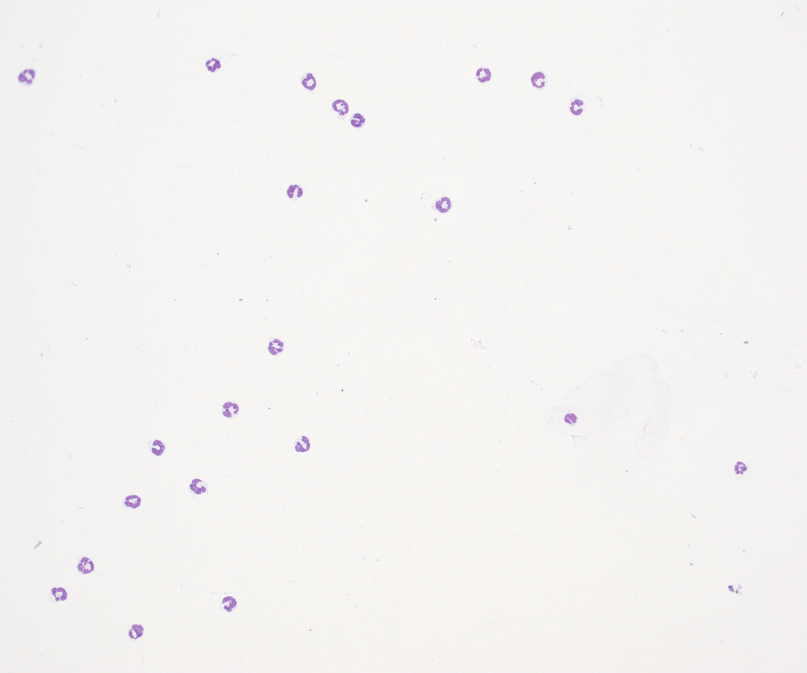

# Background

This file is an example of a Quarto Markdown File. It contains areas that consist of written text.

```{r}
#| warning: FALSE
#| message: FALSE
```


## Specific examples

This section would...

```{r}
#| eval: FALSE

# And areas that contain code (or # comments)

getwd()
```

In this walkthrough, we weill explore how we can combine these elements to not only better document our code, but also create webpages and reports.

# Getting started

The *initial code* would go **here** or ***here*** or [here]{.underline}

Link: [course website](https://umgcccfcsr.github.io/CytometryInR/course/00_Quarto/slides.html#/3/64)

```{r}
print("wait")
```

## Initial details

```{r}
#| include: FALSE

print("hello")
```


## Second details

```{r}
#| echo: FALSE
#In daily-practice, “echo: FALSE” gets often used when generating plots that we want to include in the report, without the code that generated them being displayed.
print("Lunch")
```

## Third details 

```{r}
#| code-fold: true

print("Goodbye")
```
# Wrap up

Our summary would go here

# Adding images

When reporting a bug, it is often useful to include a screenshot of what you're seeing. 
To include an image, you would include it as follows:

{width=25%}

# Additional resource

Links to useful resources go here